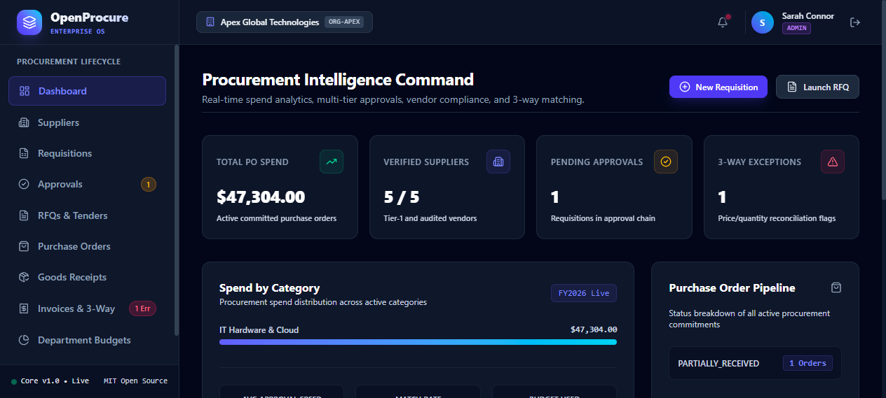
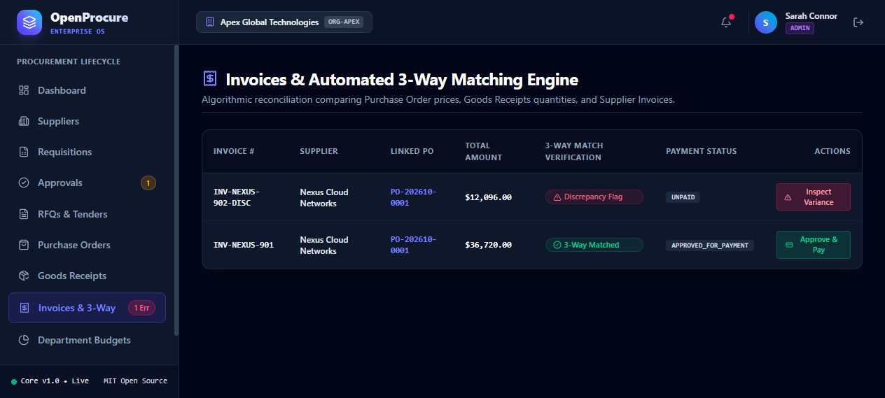
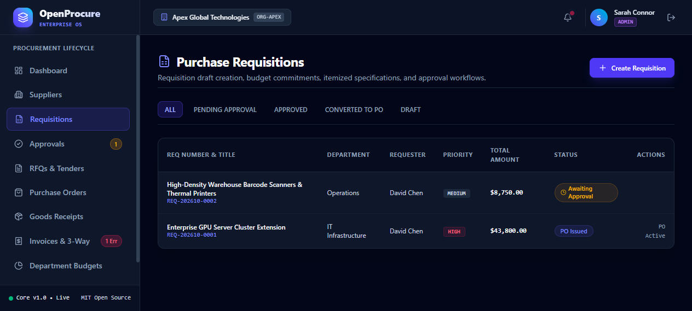
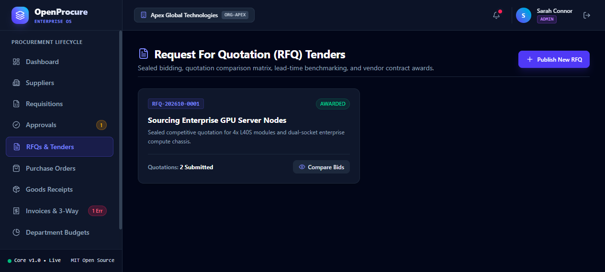

# OpenProcure — Modern Procurement & Supplier Management System

> **Open-Source Procurement, Built for Transparency, Integrity, and Operational Accountability.**

[](LICENSE)
[](https://fastapi.tiangolo.com/)
[](https://react.dev/)
[](https://tailwindcss.com/)
[](https://www.postgresql.org/)
[](apps/api/tests/)

---

## 📸 Application Showcase

### Procurement Intelligence Command & Spend Analytics


### Automated 3-Way Matching Engine & Discrepancy Diagnostics


### Purchase Requisition Management & Line Item Specifications


### Request for Quotation (RFQ) Sealed Tender Matrix & Vendor Awards


---

## 🚀 Key Features

- **Multi-Tenant Organization Isolation:** Strict tenant separation across all database queries, preventing unauthorized cross-company visibility.
- **Supplier Relationship Management (SRM):** Centralized vendor onboarding, performance rating (1-5 stars), tax identification, and payment term controls.
- **Purchase Requisitions:** Itemized requisitions with automatic server-side calculation of subtotals, taxes, and department budget commitment holds.
- **Multi-Tier Approval Governance:** Multi-level approval hierarchy with conflict-of-interest prevention (requesters cannot approve their own requests).
- **Request For Quotation (RFQ) Tenders:** Competitive quotation collection, side-by-side bid comparison matrices, and vendor award workflows.
- **Purchase Orders & Tracking:** Concurrency-safe document number generation (`PO-YYYYMM-XXXX`) with live item-by-item fulfillment indicators.
- **Warehouse Goods Receipt:** Physical inventory receiving with built-in **over-receipt prevention** to reject deliveries exceeding ordered quantities.
- **Algorithmic 3-Way Matching Engine:** Automated reconciliation comparing Purchase Orders, Goods Receipts, and Invoices. Identifies unit price variances, unreceived quantities, and over-billing exceptions with manual finance overrides.
- **Department Budgets & Spend Caps:** Real-time visibility into allocated budgets, commitment holds, and actual disbursed spend per department.
- **Append-Only Audit Trail:** Immutable system logs capturing every business event, actor, timestamp, IP address, and state transition.

---

## 🛠️ Technology Stack

| Layer | Technologies |
|-------|--------------|
| **Frontend** | React 19, TypeScript, Vite, Tailwind CSS v4, Lucide Icons, React Router |
| **Backend** | Python 3.12+, FastAPI, SQLAlchemy 2.0 ORM, Pydantic v2, PyJWT, Bcrypt |
| **Database** | PostgreSQL 16 (Production) / Standalone SQLite (Zero-Dependency Local Dev) |
| **Testing** | Pytest, FastAPI TestClient, HTTPX |
| **DevOps** | Docker, Docker Compose, Multi-Stage Builds, Nginx Alpine |

---

## 🔑 Demo Access Credentials

The deterministic database seed comes pre-configured with sample enterprise users:

| Role | Email Address | Password | Permissions |
|------|---------------|----------|-------------|
| **System Admin** | `admin@openprocure.org` | `AdminPass123!` | Full system & organization access |
| **Procurement Manager** | `procurement@openprocure.org` | `ProcurePass123!` | RFQ issuance, PO generation, Vendor awards |
| **Finance Officer** | `finance@openprocure.org` | `FinancePass123!` | 3-way match overrides, invoice payment, budgets |
| **Requester** | `requester@openprocure.org` | `RequestPass123!` | Requisition drafting and tracking |
| **Warehouse Officer** | `warehouse@openprocure.org` | `WarehousePass123!` | Dock receiving inspection & goods intake |

---

## ⚡ Quick Start (Local Development)

### 1. Prerequisites
- Python 3.11+
- Node.js 20+ and npm

### 2. Backend Setup
```bash
cd apps/api

# Create and activate virtual environment
python -m venv .venv
source .venv/bin/activate  # On Windows: .venv\Scripts\activate

# Install dependencies
pip install -r requirements.txt

# Run deterministic database seed
python seed.py

# Start REST API server (runs on port 8000)
uvicorn app.main:app --host 127.0.0.1 --port 8000 --reload
```
Interactive OpenAPI/Swagger documentation will be available at: **http://127.0.0.1:8000/api/v1/docs**

### 3. Frontend Setup
```bash
cd apps/web

# Install frontend dependencies
npm install

# Start frontend application (runs on port 5180)
npm run dev
```
Open **http://127.0.0.1:5180** in your browser.

---

## 🧪 Running Automated Tests

Run the comprehensive integration test suite verifying authentication, multi-tier approvals, over-receipt rejection, and 3-way matching logic:

```bash
cd apps/api
pytest -v
```

---

## 🐳 Docker Compose Deployment

To deploy the entire production stack (PostgreSQL + FastAPI + Nginx React Frontend):

```bash
docker compose up -d --build
```
- Frontend UI: `http://localhost:5180`
- Backend API: `http://localhost:8000`
- API Documentation: `http://localhost:8000/api/v1/docs`

---

## 📁 Repository Structure

```text
openprocure/
├── apps/
│   ├── api/                     # FastAPI Backend REST Service
│   │   ├── app/
│   │   │   ├── api/v1/          # Modular API Routes (auth, suppliers, POs, etc.)
│   │   │   ├── core/            # Database connection, security, settings
│   │   │   ├── models/          # Normalized SQLAlchemy relational entities
│   │   │   ├── schemas/         # Pydantic input/output schemas
│   │   │   └── services/        # 3-way matching, audit logger, sequence numbering
│   │   ├── tests/               # Pytest integration tests
│   │   ├── Dockerfile           # Backend container build
│   │   ├── requirements.txt     # Python dependencies
│   │   └── seed.py              # Deterministic database seeder
│   └── web/                     # React 19 Frontend Application
│       ├── src/
│       │   ├── components/      # Reusable layout & sidebar components
│       │   ├── pages/           # Dashboard, Suppliers, Requisitions, Invoices, etc.
│       │   ├── lib/             # API client & token storage
│       │   └── types/           # Shared TypeScript definitions
│       ├── Dockerfile           # Frontend container build
│       └── package.json         # Frontend dependencies
├── docs/                        # Architecture, Database, & Workflow specifications
│   ├── images/                  # High-resolution application screenshots
│   ├── ARCHITECTURE.md
│   ├── DATABASE.md
│   └── PROCUREMENT_WORKFLOWS.md
├── docker-compose.yml           # Full-stack container orchestration
├── .env.example                 # Environment configuration template
├── CONTRIBUTING.md              # Contribution guidelines
├── SECURITY.md                  # Security and vulnerability disclosure
└── LICENSE                      # MIT Open Source License
```

---

## 📄 Repository Details & License

- **GitHub Repository:** [https://github.com/0xyz-exe/openprocure](https://github.com/0xyz-exe/openprocure)
- **Author / Maintainer:** [0xyz-exe](https://github.com/0xyz-exe)
- **License:** [MIT License](LICENSE)
